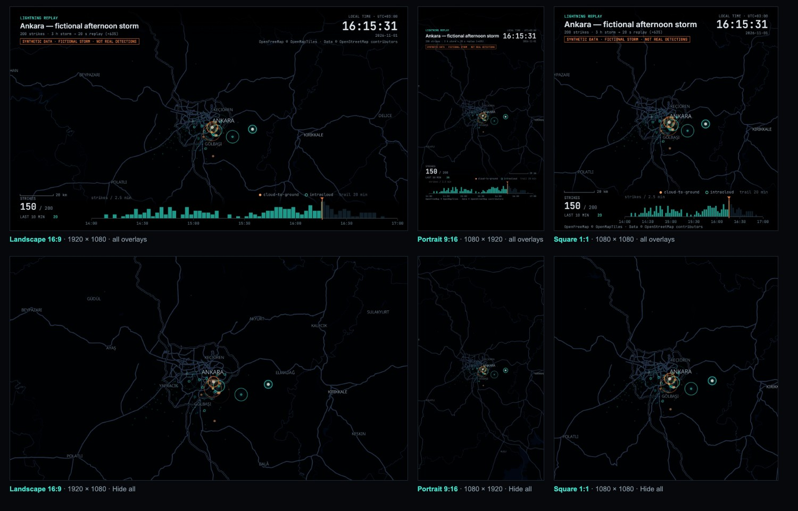
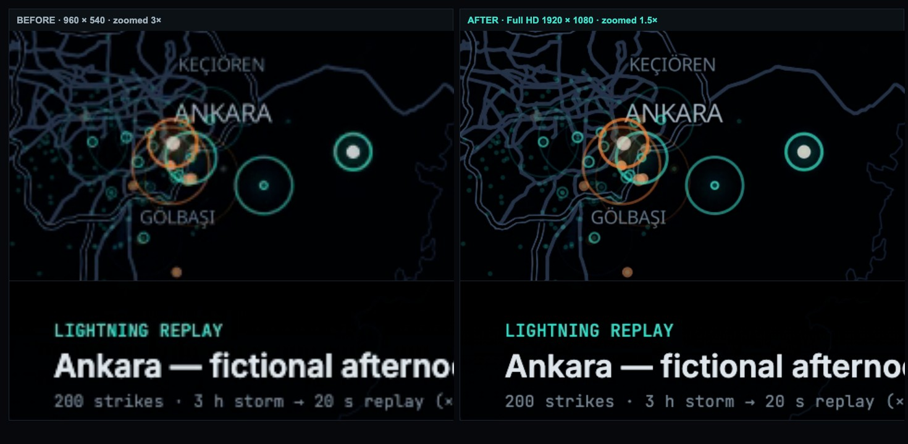
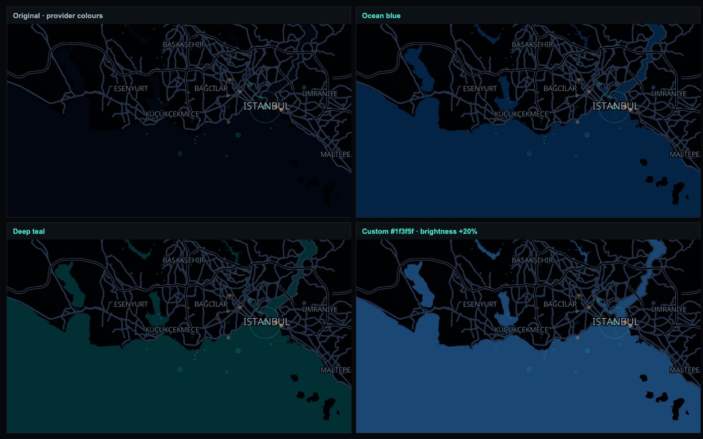
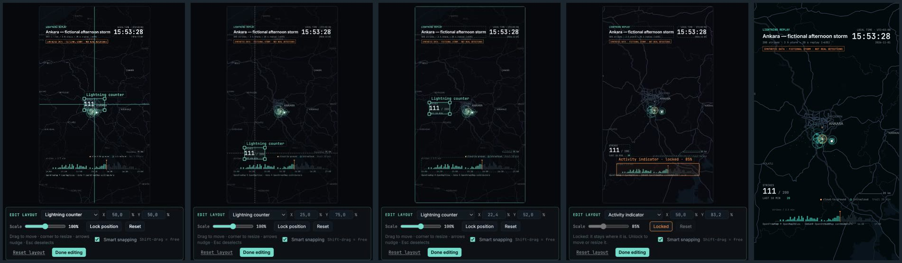

# Lightning Replay Studio v1

A local tool that turns a timestamped lightning-strike dataset (CSV or JSON) into a
geographically accurate, time-compressed storm replay. You can preview it interactively
and export it as an H.264 MP4 through the local [HyperFrames](https://github.com/heygen-com/hyperframes) renderer.

Everything runs on your Mac. There are no API keys, no accounts and no cloud rendering. The only network access is
fetching free [OpenFreeMap](https://openfreemap.org) vector tiles once when you lock a map frame; the HyperFrames
render itself never touches the network. Without internet the studio falls back to bundled Natural Earth outlines.


`demo.mp4` is a 20 s replay of the bundled **synthetic** Ankara storm. The storm is fictional: 200 strikes over 180 minutes, with no real detections.

---

## Requirements

- macOS with **Node.js 22+** (tested on Node 25.6.1)
- **FFmpeg / FFprobe** (`brew install ffmpeg`)
- **Google Chrome** (HyperFrames drives it headlessly to capture frames)

First time only, in this folder:

```bash
npm install
```

## Start the application

```bash
cd ~/Desktop/AI-Motion-Lab/lightning-replay
npm start
```

Open **http://127.0.0.1:4317**. The server listens on localhost only. Stop it with `Ctrl+C`.

## Use it after restarting the computer

Nothing needs to stay running between sessions. After a restart, open Terminal and run the two lines in
"Start the application" again. Datasets live in `data/`, and exports are written to `exports/`.
If you moved the folder or updated Node, run `npm install` once more.

## Import a new dataset

Click **Load CSV / JSON** in the sidebar, or drop a file onto it. To load one of the files in `data/`, pick it from the
list and click **Load sample**. You can also copy your own files into `data/` so they show up in that list.

**Required fields:** `timestamp`, `lat`, `lon`. **Optional fields:** `id`, `type` (`CG`, `IC` or `unknown`), `intensity`.

```json
[
  { "id": "strike-001", "timestamp": "2026-11-01T15:34:12+03:00", "lat": 39.921, "lon": 32.8541, "type": "CG", "intensity": 0.8 }
]
```

```csv
id,timestamp,lat,lon,type,intensity
strike-001,2026-11-01T15:34:12+03:00,39.9210,32.8541,CG,0.8
```

Accepted input and how it is handled:

- **JSON layout.** Either a plain array, or `{ "meta": {...}, "events": [...] }`. CSV files can carry the same
  metadata as `# key: value` lines above the header.
- **Column names.** Common aliases are accepted: `time`/`datetime`, `latitude`, `lng`/`longitude`, `amplitude`/`peak_current`.
- **Timestamps.** ISO 8601 with `Z` or `±HH:MM`, or epoch seconds/milliseconds. A timestamp with no offset is read as UTC,
  and the app shows a warning.
- **Invalid records.** Bad timestamps, latitudes outside −90…90 and longitudes outside −180…180 are rejected and listed.
  The remaining valid records still load. An empty file, or a file with no valid records, is refused with a message.
- **Ordering.** Events are sorted by time. Ties keep their original file order, and every original record is kept.
- **No deduplication.** Exact repeats (same time and position) are counted and reported but never removed.
- **Display time zone.** Taken from `meta.utcOffset`. If that is missing, the most common offset in the data is used.
- **Intensity.** It only changes marker size. It is used as-is only if `meta.intensityNormalized` is `true` (as in the
  synthetic samples). Otherwise the absolute values are rank-normalised within the dataset, so physical units such as kA
  are never assumed.
- **Observation window.** Optional `meta.windowStart` / `meta.windowEnd` declare the window the data covers
  (for the sample, 14:00–17:00). Without them, the replay runs from the first strike to the last.
- **Synthetic flag.** `meta.synthetic: true` shows a "SYNTHETIC DATA" badge in the app and in every exported frame.

## Select the video duration and other settings

All of these are in the sidebar:

| Control | Meaning |
| --- | --- |
| Video duration (s) | Length of the output video. The storm time maps linearly onto it. |
| Trail duration (storm min) | How long a residual marker stays after each strike, in *dataset* minutes |
| Marker size | Visual scale of the strike markers |
| Keep faint dot for earlier strikes | Leaves a dim dot for every past strike, so the storm's footprint builds up |
| Event time range | Optional start and end (ISO with offset). Strikes outside the range are excluded and counted. |
| Map frame: Fit to Data | Frames every strike in the time range (plus 12 % padding) inside the HUD-free area |
| Video format | Landscape 16:9, Portrait 9:16 or Square 1:1, and Full HD or Draft quality (see below) |
| Map frame: Lock Frame / Unlock | Confirms the video frame (prepares the map at the output size), or returns to editing it |
| Map layers | Show or hide roads, place names, boundaries, water and land, and set each one's opacity (see below) |
| Exact frame edges (advanced) | Type N/W/E/S; widened on one axis to keep the selected video shape |
| Video overlays | Show or hide each informational overlay, set the background shading, and **Edit layout** (see below) |

**Time mapping.** A strike at time *T* appears at
`leadIn + (T − start) / (end − start) × (duration − leadIn − tail)`. `leadIn` is 1.2 s and `tail` is 1.8 s; both
shrink for videos under 20 s. This keeps the relative spacing of strikes exact. Strikes that share a timestamp appear on the same frame.

## Choose the video format and quality

The **Video format** section has two independent settings:

| Format | Full HD output | Draft output |
| --- | --- | --- |
| Landscape 16:9 (default) | 1920 × 1080 | 960 × 540 |
| Portrait 9:16 | 1080 × 1920 | 540 × 960 |
| Square 1:1 | 1080 × 1080 | 540 × 540 |

**Full HD** (default) renders genuine Full HD: the map, strikes, rings, text and overlays are all drawn at the output
resolution, nothing is upscaled. **Draft** is the same composition at half the size with the fast encoder preset, for
checking a frame quickly. The sidebar always shows the exact pixel size.

- **Adaptive framing.** The Map Composer's guide has the selected shape, and Fit to Data fits the strikes inside the HUD-free
  part of *that* layout (and only for the HUD bands that are visible: with **Hide all** the strikes use the whole frame;
  in portrait they stay out of the platform's top and bottom interface areas). Changing the format keeps the map centre and
  fits your previous view inside the new shape, so nothing you framed is lost; the sidebar says what changed. Use Fit to Data
  to re-frame for the new shape. A prepared basemap belongs to one shape, so a locked frame returns to editing and the map
  is prepared again at the new size when you lock. Draft ↔ Full HD keeps the frame and only re-prepares the map.
- **Never a crop.** A portrait frame is a different window on the same Web Mercator map with equal east/north scale, not
  the landscape picture cropped or stretched: distances between strikes keep the same ratios in every format.
- **Same detail at any quality.** The map and the HUD are laid out on a design viewport (960 × 540, or 540 × 960 / 540 × 540)
  and rendered at 1× (Draft) or 2× (Full HD) pixel density, so both show the same features and labels; Full HD is simply
  sharper. The basemap PNG has exactly the output pixel size, and its cache identity covers size, pixel density, format,
  provider style and map layers.
- **Overlay layouts** (`src/core/layout.js`, one small table per layout family): *landscape* is the classic HUD unchanged.
  *Portrait* stacks it: title and clock at the top, below the top safe area; counter and scale bar, then the legend, then a
  full-width activity chart and the credit line at the bottom, above the bottom safe area, with larger type. Its text sits on
  light, eased scrims shaped around the two text clusters (peak 50 % tint, easing out over the platform areas) plus a soft
  dark halo on every HUD mark, so the map stays visible behind and below the HUD instead of under a dark footer. *Square* uses
  compact top and bottom bands so the map stays dominant. Texts that would meet are shortened or scaled (the title shrinks
  before it is shortened), the legend shrinks to fit, and no two overlays overlap; the eight switches stay independent and
  **Hide all** leaves no gradient in any format.
- **Encoding.** HyperFrames renders locally and encodes H.264 `yuv420p` (High profile, BT.709, `+faststart`) with
  CRF 16 at the `looks` preset for Full HD (about 1 Mbit/s for these dark map scenes), and the fast `draft` preset for Draft.
  CLI `--encode draft|looks|delivery` overrides the preset.



*The synthetic Ankara storm in all three Full HD formats, with all overlays (top) and Hide all (bottom).*



*The same frame, before (960 × 540) and after (1920 × 1080), shown at the same size: place names, road lines, strike rings and HUD text are crisp.*

## Choose the map frame (Map Composer)

A loaded dataset opens on a real, dark interactive map (MapLibre GL JS + OpenFreeMap) with its strikes as dots.

1. **Navigate.** Drag to pan, scroll or use **+ / −** to zoom. The bright rectangle is the exact video frame in the
   selected format (16:9, 9:16 or 1:1); the area outside it is dimmed, and the hatched bands inside it sit under the
   replay's HUD (in portrait also under the platform's top and bottom interface areas).
2. **Fit to Data** frames all strikes in the selected time range.
3. **Lock Frame.** The studio prepares a basemap image for exactly that frame, at the output size (about 2–5 s, cached in
   `work/basemaps/`). The stage then switches to the replay preview, drawn on that image: paused or playing, it is the
   exported video frame for frame. The sidebar reports the alignment check (MapLibre vs. replay projection).
4. **Unlock / Edit Frame** returns to the map at the same framing.

If the map cannot be loaded (offline, provider down), the composer shows the Natural Earth outlines, the sidebar says
why, and **export is blocked** until you tick *Use offline outline map* — a failed map never becomes a blank background.

**Why positions match.** MapLibre and the replay both use Web Mercator: a map camera (centre, zoom) on a W × H viewport
*is* the replay's projection with scale 512 · 2^zoom (`cameraOf` / `frameFromCamera` in `src/core/projection.js`).
The locked frame is stored as its geographic edges, the basemap is rendered by headless MapLibre at exactly the output
size (see *Choose the video format*) from the camera derived from that frame, and every strike and the basemap go
through the same projection. Map credit (OpenFreeMap © OpenMapTiles · Data © OpenStreetMap contributors) is drawn in every frame.

## Choose the map layers

The **Map layers** panel decides which geographic features appear behind the strikes. Six groups, each with an on/off
checkbox and an opacity slider, plus **Reset to defaults**:

| Group | Default | What it controls |
| --- | --- | --- |
| Major roads | on · 100 % | Motorways and main roads |
| Minor roads | on · 60 % | Streets, tracks, paths. The map data only has them from zoom 12 (street level); the panel says so when your frame is wider |
| Place names | on · 100 % | Cities, towns, districts, regions |
| Boundaries | on · 60 % (subtle) | Country borders and province/state lines (solid; includes region-shared province borders, e.g. in Türkiye) |
| Water | on · 100 % | Seas, lakes, rivers |
| Land cover & parks | on · 100 % | Forests, parks, built-up areas (the dark background always stays) |

- **Live.** While you pan and zoom, changes show on the map immediately.
- **After locking.** You can keep adjusting layers on a locked frame. Only the prepared basemap is re-baked
  (about 2–4 s, after you stop moving a slider); the frame, the replay position and the strikes do not move. The pill
  reads *updating layers…*, and **export is blocked** until the new map is ready. If the update fails the previous map
  stays on screen, the sidebar shows the error and a **Retry** button.
- **Same pixels in the MP4.** The layer settings are part of the basemap's cache key, and the export refuses a map baked
  with other layers than the ones selected. Opacity 0 hides a group like the checkbox does.
- **Any location.** Groups are matched to the provider's style layers by declarative id patterns
  (`src/map/layers.js`), not to a place. A group the style does not have is greyed out. The offline outline fallback
  has none of these layers, so the panel says so.
- **CLI.** `npm run render -- storm.csv --layers roadsMinor=off,labels=40,water=on` (`on`, `off` or a percentage).

- **Place-name letter case.** *Original map style* (default) keeps the style's CAPITALS. *Natural case* shows names as written
  in the map data (İstanbul, Şanlıurfa). The tiles already hold natural-case names and the style only upper-cases them with
  `text-transform`, so natural case simply switches that off: no text is ever re-cased by the studio, and Turkish
  İ/ı/Ş/Ğ stay intact (the stock upper-casing even turns "Başakşehir" into "BAŞAKŞEHIR" with a plain I). A name the
  source itself stores in capitals stays in capitals. CLI: `--layers labelCase=natural`.
- **Roads at wide zooms.** The map data is generalised by zoom: motorways and trunk/primary roads from the
  start, secondary from about zoom 9, tertiary from 11, minor streets from 12. A road that changes class along its
  length can therefore look broken in a wide frame and joins up as you zoom in; that is the source data, not the styling.
  Roads under construction and railways are not drawn.
- **Water appearance.** The Water row has a colour preset (*Original*, *Ocean blue*, *Deep teal*, *Custom* with a colour picker),
  a **Brightness** slider (−50…+50 %, lightness ×½…×2, never pushed past a moderate ceiling) and **Reset** (provider colours,
  full opacity). Opacity and visibility keep working and are independent of colour and brightness. In the OpenFreeMap style
  water is two layers, `water` (sea, ocean, lakes) and `waterway` (rivers, canals); both are recoloured by changing their
  MapLibre paint colour (rivers a touch lighter, as in the provider's own style). Nothing else is touched, no filter is
  applied to the map, and *Original* writes the provider's exact colour back. The interactive map and the baked PNG use the same
  patches, so the composer, the locked preview and every export (Full HD, Draft, all formats) show the same water. Changing it
  on a locked frame only re-prepares the map; the replay, the strikes and the alignment do not move. The default
  Original/0 % state keeps its existing cache entries. CLI: `--layers waterColor=blue|teal|#1f3f5f,waterBrightness=20`.
  The stock dark sea is almost the colour of the land, which makes coastlines hard to read on a phone; Ocean blue and Deep teal
  are dark enough to keep the cinematic look but separate sea from land.



*The Marmara coast of İstanbul (synthetic storm), Full HD: Original, Ocean blue, Deep teal, and a custom colour.*

- **Lat / Lon grid.** Off by default, with its own opacity slider (50 % by default). It is drawn by the replay renderer
  on top of the map (so the preview and the MP4 share it) and does not re-bake the map. CLI: `--grid --grid-opacity 0.4`.


*Ankara, İstanbul and São Paulo, default layers (left) vs. minor roads and land off, labels 50 %, water 60 %, boundaries 100 % (right).*

## Choose the video overlays

Everything informational the replay draws above the map is a switch in the **Video overlays** panel. Strikes, flashes,
rings, trails and the map itself are the animation and are never overlays. The defaults keep the classic look.

| Overlay | Default | Shows |
| --- | --- | --- |
| Title | on | "LIGHTNING REPLAY", the dataset title and the storm summary line |
| Clock / timestamp | on | Local time zone, time and date |
| Lightning counter | on | Running strike count and "last 10 min" |
| Activity indicator | on | Strikes-over-time chart with the playhead and time ticks |
| Scale bar | on | Distance scale |
| Legend | on | Strike types and trail length |
| Synthetic-data notice | on | The "SYNTHETIC DATA" badge (only drawn for datasets flagged synthetic) |
| Attribution | on | Map and data credit line in the frame |

**Hide all** gives a clean frame: only the map (with the selected map layers and, if enabled, the Lat / Lon grid) and the
animated strikes; the dark text bands disappear too. **Reset** restores the defaults. Switches apply instantly, paused or
playing, without rebuilding the map, re-baking the basemap or moving the replay. The export uses the settings selected at
that moment. CLI: `--overlays none`, `--overlays title,clock` (keep only those), default `all`.

**Attribution.** Switching it off only removes the credit from the picture. **Copy attribution** copies the credit lines for
the map provider and the dataset's recorded source, and every export also writes them into the MP4's `comment` tag and a
`<video>.credits.txt` next to it. Check the attribution and licence terms of OpenFreeMap / OpenStreetMap and of your data
source before publishing without in-frame credit: credit outside the frame may not satisfy them.
The synthetic-data notice is included in Hide all, so a clean video of a synthetic dataset carries no "fictional" label:
label it yourself when you publish it.

## Edit the overlay layout

With the frame locked, **Edit layout** (under the preview, or in the Video overlays panel) turns the preview into a layout
editor for the eight overlays. Playback, scrubbing and the map are unaffected, and nothing of the editor is ever drawn into
the video: it is a layer of outlines above the canvas, while every change goes into the same layout settings the canvas
renderer draws from in the preview and in the MP4.



*Synthetic Ankara storm, portrait Full HD: snapping to the frame centre and to the quarter lines, a locked overlay while
another one moves, the chart scaled to 85 % on the bottom safe line with shading off, and that frame in the exported MP4.*

- **Select** an overlay by clicking it (faint outlines show what is selectable; the smallest box wins where boxes overlap,
  the selected one first), or from the inspector's list, which also reaches hidden overlays without showing them.
- **Move** by dragging (mouse, pen or touch). The overlay keeps the point you grabbed under the pointer and stays inside the
  frame. **Resize** by dragging a corner handle: the opposite corner stays put. **Arrow keys** nudge (Shift = 10×),
  **Esc** cancels a drag, then clears the selection.
- **Smart snapping** (on by default) aligns the overlay's edges or centre to the frame centre (solid turquoise guide),
  the quarter lines, the edge margins, the portrait safe areas (orange) and the other visible overlays, one guide per axis.
  It captures within 6 CSS px and lets go once the pointer is 10 px past it; after letting go nothing captures again for
  another 6 px, so dragging on through a guide never sticks or jumps back. Overlay-to-overlay guides use 60 % of those
  distances. Shift-drag, or the checkbox, turns it off.
- **Inspector**: position of the overlay's centre (% of the frame), **Scale** 50–150 % (never larger than the frame),
  **Lock position** (that overlay only; unrelated to Lock Frame), **Reset** (this overlay) and **Reset layout** (every
  overlay of the current format). **Done editing** leaves the mode.

Each format keeps its own layout for the session (`final layout = format preset + your overrides`): editing portrait never
moves landscape or square, switching back restores your edits, Draft ↔ Full HD keeps them, and Hide all keeps them too.
An override stores the overlay's anchor (its natural corner or edge, e.g. the clock's top-right) as a fraction of the frame
plus a scale, so one layout renders at the same relative place in Draft and Full HD. Layout edits never rebuild the replay,
re-bake the map or move the playhead, and they never affect timestamps, strike positions, counts or the projection.

**Background shading** (Video overlays panel): **Standard** is each format's preset look, **Subtle** half of it, **Off** no
backing gradients at all (text, chart, lightning and map stay); the slider sets any value between. Text keeps a soft dark
halo whenever the shading is lighter than Standard (always in portrait). An overlay you move into the middle of the frame
gets its own soft local backing instead of a band. Shading never touches the map image.

CLI: `--layout layout.json` (an overlay layout, plain or keyed by format, e.g.
`{"portrait": {"activity": {"x": 0.5, "y": 0.865, "scale": 0.85}}}`) and `--shading off|subtle|standard|0…1`.

## Preview an event

- Press **Play** or hit `Space` to play. Drag the scrubber to move freely. When paused, the preview snaps to the
  export frame grid (24 fps), so what you see is exactly an exported frame.
- Click any row in the **Strikes** table to jump to the first frame where that strike flashes. A crosshair marks it.
  The crosshair appears in the preview only, not in the export.
- `[` and `]` step to the previous or next strike. `←` and `→` step one frame at a time.
- Use the search box to filter strikes by id, local time or type.

## Export a new MP4

**From the app.** Choose the format and quality, lock the frame and click **Export MP4**. The render runs locally, and a
20 s Full HD video takes about 8 s on an M4. The finished file is checked with ffprobe (codec, size, fps, duration, frame
count) and can be played and downloaded in the sidebar. Files are saved to `exports/`, named with the format and size.

**From the command line,** using the same pipeline:

```bash
npm run render -- data/sample-ankara-storm.json -o demo.mp4 --duration 20
```

```bash
npm run render -- data/sample-ankara-storm.json -o exports/ankara-portrait.mp4 --format portrait
npm run render -- data/sample-ankara-storm.json -o exports/ankara-square-draft.mp4 --format square --quality draft
```

```bash
npm run render -- my-storm.csv -o exports/my-storm-45s.mp4 --duration 45 --trail 15 --scale 1.2
```

```bash
npm run render -- my-storm.csv -o exports/zoomed.mp4 --bounds 32.6,39.75,33.1,40.05 --start 2026-11-01T15:00:00+03:00
```

The CLI prepares the same dark map (Fit to Data unless `--frame west,south,east,north` or `--bounds` is given). If the map
cannot be prepared it stops; add `--outline` to export with the offline Natural Earth outlines instead.

Format options: `--format landscape|portrait|square` (default landscape) and `--quality hd|draft` (default `hd` = Full HD).
Other CLI options: `--layers` (map layers, see above), `--overlays`, `--layout`, `--shading` (overlay layout and HUD
shading, see above), `--fps`, `--encode draft|looks|delivery` (x264 preset),
`--width`/`--height` (an explicit size instead of `--format`/`--quality`, for advanced use), `--title`, `--keep` (keeps the
generated HyperFrames project in `work/`).

To build a contact sheet from any MP4:

```bash
node scripts/contact-sheet.js demo.mp4 contact-sheet.png
```

## Tests

```bash
npm test
```

Focused tests (`npm run test:map` runs only the map ones):

1. Timeline positions are correct.
2. Events are sorted chronologically and invalid input is rejected.
3. Geographic projection is consistent.
4. Strikes with the same timestamp appear on the same frame.
5. The preview and the export use identical time mapping.
6. A real 4 s HyperFrames render, plus `demo.mp4`, match the requested duration, fps and size. 6c renders an MP4 over a
   MapLibre basemap with rings at known coordinates and checks rings and strike markers land on the same pixels.
7. The MapLibre camera and the replay projection are the same transform.
8. Fit to Data, pan, zoom and lock define the frame; time compression and ordering are unchanged.
9. A prepared basemap travels into the composition unchanged; a basemap for another frame is refused.
10. Headless MapLibre draws known coordinates exactly where the replay does (offline style, no network).
11. Map download failures are reported, never baked as a blank map.
12. Layer defaults, reset, visibility, opacity clamping and invalid input.
13. Layer groups reach the real OpenFreeMap layer ids (recorded in `tests/fixtures/`); missing layers are tolerated.
14. A baked basemap changes with the layers, its cache key covers them, and a layer change leaves the frame,
    alignment and strike coordinates untouched. 14b: a style without any of the groups still bakes.
15. The interactive MapLibre map and the baked PNG render the same pixels for the same layers.
16. Layers behave the same for İstanbul and a southern-hemisphere fixture (São Paulo, synthetic).
6d. An MP4 rendered with non-default layers shows exactly those layers.
24. Format presets: Full HD and Draft sizes, aspect ratios, validation, defaults.
25. Framing per format: Fit to Data respects the visible HUD, Hide all frees the frame, pan/zoom/lock behave.
26. A format change keeps the centre and the old view; strikes stay geographically exact and unstretched; Draft = Full HD / 2.
27. Overlay layout in every format and quality: no text overlaps, all text on a HUD band, portrait safe areas, legibility (+ a stress case).
28. The three layouts: classic landscape coordinates, stacked portrait, compact square.
28b. Portrait backing is a light, eased scrim with a text halo (no dark footer); landscape and square keep their classic bands.
29. Hide all: a completely clean frame in every format; each overlay stays on its own band.
30. The basemap is baked at the output size (real MapLibre, offline style); cache identity covers size, format, layers.
31. The composition declares the selected size.
32–36. Water appearance: model, validation and cache identity; patches on the provider's real layers (only water changes, Original
    is exact, presets separate sea from land, Reset restores); bounded brightness independent of opacity; real MapLibre bakes
    (custom colour, brightness, opacity, nothing else moves, alignment unchanged); exported MP4 water colour in all formats and
    both qualities. 15b: interactive map and baked PNG match pixel for pixel with water colour.
6f. Real Full HD MP4s in all three formats: size, fps, frame count, H.264 profile, strike and basemap alignment to the pixel,
    and a clean Hide all frame.
32. Overlay layout overrides: validation, clamping, per-format entries.
33. Normalized placement: presets unchanged; one layout is the same relative composition in Draft and Full HD.
34. The renderer moves and scales a whole overlay group; untouched overlays and chart values stay; the preset draws exactly as before.
35. Layout and shading never change events, counts, projection, camera or the prepared map (no re-bake).
36. HUD shading Off / Subtle / Standard, halo, and a clean Hide all with a custom layout.
37. Backing follows moved overlays: bands only while an overlay sits in them, a soft local backing mid-frame.
38. Overlay geometry is measured from the renderer, for every overlay and format, hidden ones included.
39. Preview/export parity: the composition carries the exact layout and shading and draws the same calls.
40. CSS preview px ↔ output px at any preview size and quality.
41. Dragging keeps the grab offset, clamps to the frame, and lands at the same relative place in Draft and Full HD.
42. Snapping: capture, hysteresis, release without jumps or drift, quiet zone, competing targets, snapping off.
43. Snap targets: frame centre, quarters, margins, portrait safe areas, other overlays.
44. Scaling about the anchor, corner resize (opposite corner fixed), frame-size limit, arrow nudges.
45. Per-format layout store: isolation, lock, Reset selected / Reset layout, Hide all keeps positions.
6g. An exported MP4 reproduces a custom overlay position, scale and shading, with no editor marks.

## Project layout

```
app/                 interactive preview (HTML/CSS/JS, no build step) · composer.js (Map Composer) · layout-editor.js (Edit layout)
src/core/            parse.js · timeline.js · projection.js · replay.js · format.js · layout.js · overlays.js · hud.js · draw.js
                     shared by the preview AND the exported video (copied byte-identical)
src/map/             providers.js (map provider + dark style tuning + offline style) · layers.js (layer groups) · render-basemap.js (headless bake)
src/editor/          layout-edit.js (layout editor geometry: coordinates, snapping, scaling, per-format store)
src/export/          composition.js (writes the HyperFrames project) · render.js (render + ffprobe)
server.js            local server: static files + /api/basemap + /api/export
scripts/             render.js (CLI) · generate-sample.js · contact-sheet.js · build-basemap.js
basemap/             ne-50m.json (Natural Earth 1:50m coastlines/borders) · places.json (approx. reference places)
data/                synthetic sample datasets (JSON + CSV)
assets/fonts/        Inter + JetBrains Mono (OFL) used by both preview and export
tests/               node:test files
```

To regenerate derived data: `npm run sample` rebuilds the synthetic datasets (fixed seed, byte-identical output), and
`npm run basemap` rebuilds the basemap from the `world-atlas` package.
