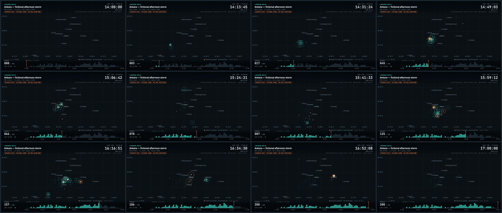
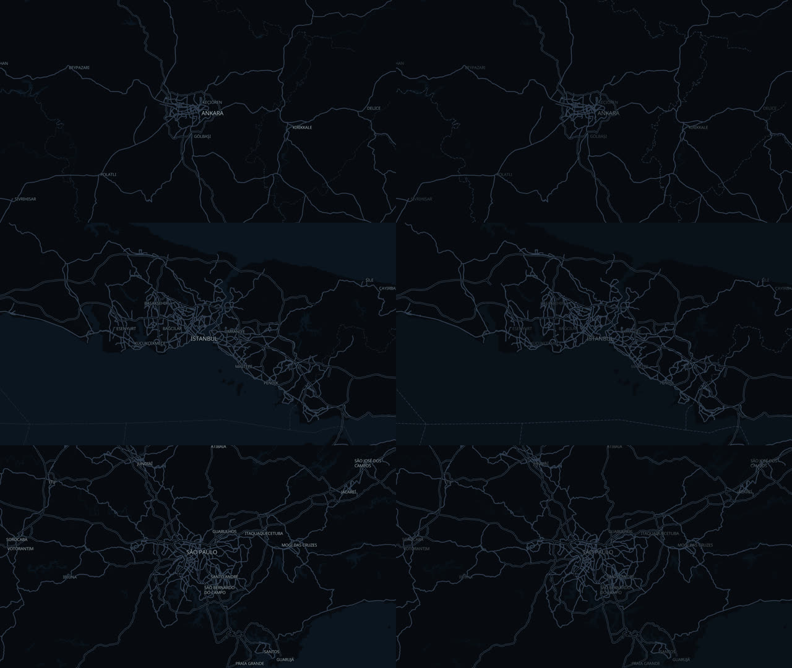

# Lightning Replay Studio v1

A local tool that turns a timestamped lightning-strike dataset (CSV or JSON) into a
geographically accurate, time-compressed storm replay. You can preview it interactively
and export it as an H.264 MP4 through the local [HyperFrames](https://github.com/heygen-com/hyperframes) renderer.

Everything runs on your Mac. There are no API keys, no accounts and no cloud rendering. The only network access is
fetching free [OpenFreeMap](https://openfreemap.org) vector tiles once when you lock a map frame; the HyperFrames
render itself never touches the network. Without internet the studio falls back to bundled Natural Earth outlines.



`demo.mp4` is a 20 s replay of the bundled **synthetic** Ankara storm. The storm is fictional: 200 strikes over 180 minutes, with no real detections.

---

## Requirements

- macOS with **Node.js 22+** (tested on Node 25.6.1)
- **FFmpeg / FFprobe** (`brew install ffmpeg`)
- **Google Chrome** (HyperFrames drives it headlessly to capture frames)

First time only, in this folder:

```bash
npm install
```

## Start the application

```bash
cd ~/Desktop/AI-Motion-Lab/lightning-replay
npm start
```

Open **http://127.0.0.1:4317**. The server listens on localhost only. Stop it with `Ctrl+C`.

## Use it after restarting the computer

Nothing needs to stay running between sessions. After a restart, open Terminal and run the two lines in
"Start the application" again. Datasets live in `data/`, and exports are written to `exports/`.
If you moved the folder or updated Node, run `npm install` once more.

## Import a new dataset

Click **Load CSV / JSON** in the sidebar, or drop a file onto it. To load one of the files in `data/`, pick it from the
list and click **Load sample**. You can also copy your own files into `data/` so they show up in that list.

**Required fields:** `timestamp`, `lat`, `lon`. **Optional fields:** `id`, `type` (`CG`, `IC` or `unknown`), `intensity`.

```json
[
  { "id": "strike-001", "timestamp": "2026-11-01T15:34:12+03:00", "lat": 39.921, "lon": 32.8541, "type": "CG", "intensity": 0.8 }
]
```

```csv
id,timestamp,lat,lon,type,intensity
strike-001,2026-11-01T15:34:12+03:00,39.9210,32.8541,CG,0.8
```

Accepted input and how it is handled:

- **JSON layout.** Either a plain array, or `{ "meta": {...}, "events": [...] }`. CSV files can carry the same
  metadata as `# key: value` lines above the header.
- **Column names.** Common aliases are accepted: `time`/`datetime`, `latitude`, `lng`/`longitude`, `amplitude`/`peak_current`.
- **Timestamps.** ISO 8601 with `Z` or `±HH:MM`, or epoch seconds/milliseconds. A timestamp with no offset is read as UTC,
  and the app shows a warning.
- **Invalid records.** Bad timestamps, latitudes outside −90…90 and longitudes outside −180…180 are rejected and listed.
  The remaining valid records still load. An empty file, or a file with no valid records, is refused with a message.
- **Ordering.** Events are sorted by time. Ties keep their original file order, and every original record is kept.
- **No deduplication.** Exact repeats (same time and position) are counted and reported but never removed.
- **Display time zone.** Taken from `meta.utcOffset`. If that is missing, the most common offset in the data is used.
- **Intensity.** It only changes marker size. It is used as-is only if `meta.intensityNormalized` is `true` (as in the
  synthetic samples). Otherwise the absolute values are rank-normalised within the dataset, so physical units such as kA
  are never assumed.
- **Observation window.** Optional `meta.windowStart` / `meta.windowEnd` declare the window the data covers
  (for the sample, 14:00–17:00). Without them, the replay runs from the first strike to the last.
- **Synthetic flag.** `meta.synthetic: true` shows a "SYNTHETIC DATA" badge in the app and in every exported frame.

## Select the video duration and other settings

All of these are in the sidebar:

| Control | Meaning |
| --- | --- |
| Video duration (s) | Length of the output video. The storm time maps linearly onto it. |
| Trail duration (storm min) | How long a residual marker stays after each strike, in *dataset* minutes |
| Marker size | Visual scale of the strike markers |
| Keep faint dot for earlier strikes | Leaves a dim dot for every past strike, so the storm's footprint builds up |
| Event time range | Optional start and end (ISO with offset). Strikes outside the range are excluded and counted. |
| Map frame: Fit to Data | Frames every strike in the time range (plus 12 % padding) inside the HUD-free area |
| Map frame: Lock Frame / Unlock | Confirms the 16:9 frame (prepares the map), or returns to editing it |
| Map layers | Show or hide roads, place names, boundaries, water and land, and set each one's opacity (see below) |
| Exact frame edges (advanced) | Type N/W/E/S; widened on one axis to keep the video's 16:9 shape |

**Time mapping.** A strike at time *T* appears at
`leadIn + (T − start) / (end − start) × (duration − leadIn − tail)`. `leadIn` is 1.2 s and `tail` is 1.8 s; both
shrink for videos under 20 s. This keeps the relative spacing of strikes exact. Strikes that share a timestamp appear on the same frame.

## Choose the map frame (Map Composer)

A loaded dataset opens on a real, dark interactive map (MapLibre GL JS + OpenFreeMap) with its strikes as dots.

1. **Navigate.** Drag to pan, scroll or use **+ / −** to zoom. The bright rectangle is the exact 960 × 540 video frame;
   the area outside it is dimmed, and the hatched bands inside it sit under the replay's title and timeline HUD.
2. **Fit to Data** frames all strikes in the selected time range.
3. **Lock Frame.** The studio prepares a basemap image for exactly that frame (about 2–4 s, cached in
   `work/basemaps/`). The stage then switches to the replay preview, drawn on that image: paused or playing, it is the
   exported video frame for frame. The sidebar reports the alignment check (MapLibre vs. replay projection).
4. **Unlock / Edit Frame** returns to the map at the same framing.

If the map cannot be loaded (offline, provider down), the composer shows the Natural Earth outlines, the sidebar says
why, and **export is blocked** until you tick *Use offline outline map* — a failed map never becomes a blank background.

**Why positions match.** MapLibre and the replay both use Web Mercator: a map camera (centre, zoom) on a W × H viewport
*is* the replay's projection with scale 512 · 2^zoom (`cameraOf` / `frameFromCamera` in `src/core/projection.js`).
The locked frame is stored as its geographic edges, the basemap is rendered by headless MapLibre at exactly 960 × 540
(×2 pixel ratio) from the camera derived from that frame, and every strike and the basemap go through the same
projection. Map credit (OpenFreeMap © OpenMapTiles · Data © OpenStreetMap contributors) is drawn in every frame.

## Choose the map layers

The **Map layers** panel decides which geographic features appear behind the strikes. Six groups, each with an on/off
checkbox and an opacity slider, plus **Reset to defaults**:

| Group | Default | What it controls |
| --- | --- | --- |
| Major roads | on · 100 % | Motorways and main roads |
| Minor roads | on · 60 % | Streets, tracks, paths. The map data only has them from zoom 12 (street level); the panel says so when your frame is wider |
| Place names | on · 100 % | Cities, towns, districts, regions |
| Boundaries | on · 60 % (subtle) | Country borders and province/state lines (solid; includes region-shared province borders, e.g. in Türkiye) |
| Water | on · 100 % | Seas, lakes, rivers |
| Land cover & parks | on · 100 % | Forests, parks, built-up areas (the dark background always stays) |

- **Live.** While you pan and zoom, changes show on the map immediately.
- **After locking.** You can keep adjusting layers on a locked frame. Only the prepared basemap is re-baked
  (about 2–4 s, after you stop moving a slider); the frame, the replay position and the strikes do not move. The pill
  reads *updating layers…*, and **export is blocked** until the new map is ready. If the update fails the previous map
  stays on screen, the sidebar shows the error and a **Retry** button.
- **Same pixels in the MP4.** The layer settings are part of the basemap's cache key, and the export refuses a map baked
  with other layers than the ones selected. Opacity 0 hides a group like the checkbox does.
- **Any location.** Groups are matched to the provider's style layers by declarative id patterns
  (`src/map/layers.js`), not to a place. A group the style does not have is greyed out. The offline outline fallback
  has none of these layers, so the panel says so.
- **CLI.** `npm run render -- storm.csv --layers roadsMinor=off,labels=40,water=on` (`on`, `off` or a percentage).

- **Place-name letter case.** *Original map style* (default) keeps the style's CAPITALS. *Natural case* shows names as written
  in the map data (İstanbul, Şanlıurfa). The tiles already hold natural-case names and the style only upper-cases them with
  `text-transform`, so natural case simply switches that off: no text is ever re-cased by the studio, and Turkish
  İ/ı/Ş/Ğ stay intact (the stock upper-casing even turns "Başakşehir" into "BAŞAKŞEHIR" with a plain I). A name the
  source itself stores in capitals stays in capitals. CLI: `--layers labelCase=natural`.
- **Roads at wide zooms.** The map data is generalised by zoom: motorways and trunk/primary roads from the
  start, secondary from about zoom 9, tertiary from 11, minor streets from 12. A road that changes class along its
  length can therefore look broken in a wide frame and joins up as you zoom in; that is the source data, not the styling.
  Roads under construction and railways are not drawn.
- **Lat / Lon grid.** Off by default, with its own opacity slider (50 % by default). It is drawn by the replay renderer
  on top of the map (so the preview and the MP4 share it) and does not re-bake the map. CLI: `--grid --grid-opacity 0.4`.



*Ankara, İstanbul and São Paulo, default layers (left) vs. minor roads and land off, labels 50 %, water 60 %, boundaries 100 % (right).*

## Preview an event

- Press **Play** or hit `Space` to play. Drag the scrubber to move freely. When paused, the preview snaps to the
  export frame grid (24 fps), so what you see is exactly an exported frame.
- Click any row in the **Strikes** table to jump to the first frame where that strike flashes. A crosshair marks it.
  The crosshair appears in the preview only, not in the export.
- `[` and `]` step to the previous or next strike. `←` and `→` step one frame at a time.
- Use the search box to filter strikes by id, local time or type.

## Export a new MP4

**From the app.** Choose a quality (Draft, Standard or High) and click **Export MP4**. The render runs locally, and a
20 s video takes about 7 s on an M4. The finished file is checked with ffprobe (codec, size, fps, duration, frame count) and
can be played and downloaded in the sidebar. Files are saved to `exports/`.

**From the command line,** using the same pipeline:

```bash
npm run render -- data/sample-ankara-storm.json -o demo.mp4 --duration 20 --quality delivery
```

```bash
npm run render -- my-storm.csv -o exports/my-storm-45s.mp4 --duration 45 --trail 15 --scale 1.2
```

```bash
npm run render -- my-storm.csv -o exports/zoomed.mp4 --bounds 32.6,39.75,33.1,40.05 --start 2026-11-01T15:00:00+03:00
```

The CLI prepares the same dark map (Fit to Data unless `--frame west,south,east,north` or `--bounds` is given). If the map
cannot be prepared it stops; add `--outline` to export with the offline Natural Earth outlines instead.

Other CLI options: `--layers` (map layers, see above), `--fps`, `--width`/`--height` (16:9 recommended), `--title`, `--keep` (keeps the
generated HyperFrames project in `work/`).

To build a contact sheet from any MP4:

```bash
node scripts/contact-sheet.js demo.mp4 contact-sheet.png
```

## Tests

```bash
npm test
```

Focused tests (`npm run test:map` runs only the map ones):

1. Timeline positions are correct.
2. Events are sorted chronologically and invalid input is rejected.
3. Geographic projection is consistent.
4. Strikes with the same timestamp appear on the same frame.
5. The preview and the export use identical time mapping.
6. A real 4 s HyperFrames render, plus `demo.mp4`, match the requested duration, fps and size. 6c renders an MP4 over a
   MapLibre basemap with rings at known coordinates and checks rings and strike markers land on the same pixels.
7. The MapLibre camera and the replay projection are the same transform.
8. Fit to Data, pan, zoom and lock define the frame; time compression and ordering are unchanged.
9. A prepared basemap travels into the composition unchanged; a basemap for another frame is refused.
10. Headless MapLibre draws known coordinates exactly where the replay does (offline style, no network).
11. Map download failures are reported, never baked as a blank map.
12. Layer defaults, reset, visibility, opacity clamping and invalid input.
13. Layer groups reach the real OpenFreeMap layer ids (recorded in `tests/fixtures/`); missing layers are tolerated.
14. A baked basemap changes with the layers, its cache key covers them, and a layer change leaves the frame,
    alignment and strike coordinates untouched. 14b: a style without any of the groups still bakes.
15. The interactive MapLibre map and the baked PNG render the same pixels for the same layers.
16. Layers behave the same for İstanbul and a southern-hemisphere fixture (São Paulo, synthetic).
6d. An MP4 rendered with non-default layers shows exactly those layers.

## Project layout

```
app/                 interactive preview (HTML/CSS/JS, no build step) · composer.js (Map Composer)
src/core/            parse.js · timeline.js · projection.js · replay.js · draw.js
                     shared by the preview AND the exported video (copied byte-identical)
src/map/             providers.js (map provider + dark style tuning + offline style) · layers.js (layer groups) · render-basemap.js (headless bake)
src/export/          composition.js (writes the HyperFrames project) · render.js (render + ffprobe)
server.js            local server: static files + /api/basemap + /api/export
scripts/             render.js (CLI) · generate-sample.js · contact-sheet.js · build-basemap.js
basemap/             ne-50m.json (Natural Earth 1:50m coastlines/borders) · places.json (approx. reference places)
data/                synthetic sample datasets (JSON + CSV)
assets/fonts/        Inter + JetBrains Mono (OFL) used by both preview and export
tests/               node:test files
```

To regenerate derived data: `npm run sample` rebuilds the synthetic datasets (fixed seed, byte-identical output), and
`npm run basemap` rebuilds the basemap from the `world-atlas` package.
